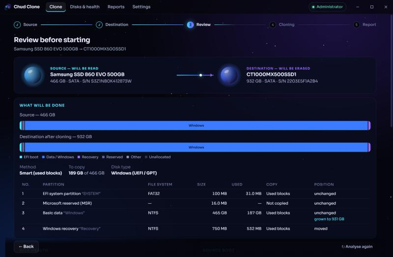
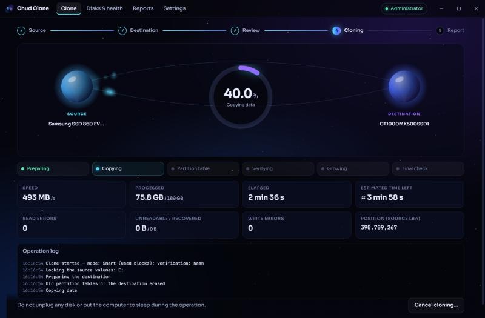
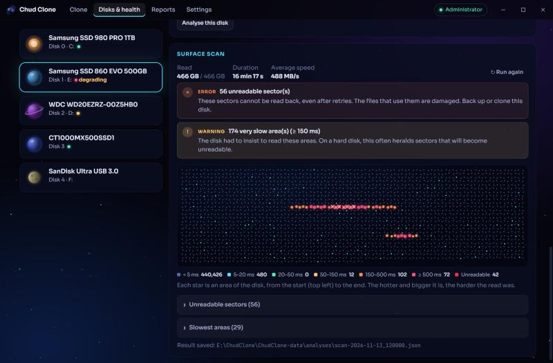

<p align="center">
  
</p>

<h1 align="center">Chud Clone</h1>

<p align="center">
  <b>Disk cloning and diagnostics for Windows 10/11 (x64)</b><br>
  HDD · SATA SSD · NVMe · USB · disk images. One Rust engine, behind a graphical app and a command line.
</p>

<p align="center">
  
  
  
  
</p>

<p align="center">
  
</p>

Chud Clone copies a disk to another disk or to an image file, **checks** that the copy is
identical, and tells you plainly whether the result can be trusted. It also reads disk health
(SMART), tracks how it changes over time, and scans disk surfaces for slow or unreadable areas.
No telemetry, no account. The only network access is an optional update check against this
repository's GitHub releases.

> [!NOTE]
> The engine is validated on disk images, virtual disks (automated tests plus checks by independent
> tools) and, since 0.3.0, on real disks. See [Known limitations](#known-limitations). As with any
> cloning tool, keep your source disk intact until the clone has been checked in real use.

## Features

- **Cloning** of GPT/UEFI and MBR/BIOS disks: *smart* (used blocks only) or sector by sector, to a
  larger or smaller destination, disk ↔ disk ↔ image file.
- **Clone a Windows disk connected externally** (USB enclosure, dock, second internal disk) to
  another disk or to an image file. Since it is not the running system, its volumes are locked and
  dismounted during the copy so nothing changes underneath.
- **Automatic growth**: on a larger disk the Windows partition (NTFS) is extended over the added
  space, after the copy has been verified.
- **Verification** after every copy (read-back with BLAKE3 checksums, or a full source/destination
  comparison) and a **report** in TXT, HTML and JSON.
- **Unreadable sectors are never skipped silently**: the engine isolates damaged areas, retries
  them sector by sector, then asks you what to do and lists every affected LBA.
- **Disk health**: SMART for ATA, SAT (USB) and NVMe, a history kept at every reading, and alerts
  when something gets worse (pending or reallocated sectors, temperature, wear…).
- **Read-only surface scan** with a "star map" of the disk, unreadable sectors and slow areas.
- **Several clones in a row**: pick several destinations for the same source, confirm once, and
  they are cloned one after another (a failure does not stop the next ones). Optionally eject
  each destination and shut the computer down at the end (60-second countdown, cancellable).
  A sound tells success from failure.
- **Whole-disk formatting**: new GPT or MBR table, one NTFS, exFAT or FAT32 partition with the
  name you choose, after the same typed confirmation. FAT32 works beyond Windows' 32 GB limit.
  Also on the WinPE key (`M`).
- **No sleep while the application is open** (can be turned off in Settings); in any case the
  computer stays awake while a clone, a scan or a format runs.
- **WinPE rescue ISO** (bootable from Ventoy or a USB key), with a full-screen keyboard interface,
  to clone the disk Windows itself runs
  from, with the computer booted on the key.
- **Fast USB docks**: the source is read ahead while the destination is written, so a clone
  between two disks of the same dock uses both directions of the USB link at once.
- **English and French**: interface, diagnostics, reports and command line. The language follows
  Windows and can be changed in Settings.
- **Updates from inside the app**: a new release is announced at startup and installed in a click,
  after its SHA-256 checksum has been verified (installed and portable versions).
- A space-themed interface with a reduced-motion mode. During a clone, the progress ring is a star:
  it grows while the data is copied, explodes when the copy is complete, and cools down into a
  brown dwarf once the clone is verified.

<table>
  <tr>
    <td></td>
    <td></td>
  </tr>
  <tr>
    <td align="center"><sub>Clone in progress</sub></td>
    <td align="center"><sub>Surface scan of a degrading SSD</sub></td>
  </tr>
</table>

## Download

Grab the latest build from the [Releases page](https://github.com/BigFatDeuce/Chud-Clone/releases).

| File | Use |
| --- | --- |
| `ChudClone-0.6.1-setup.exe` | Installs into Program Files (administrator rights), Start menu/desktop shortcuts, clean uninstall (reports in `%APPDATA%\ChudClone` are kept). English or French wizard. |
| `ChudClone-0.6.1-portable.zip` | Unzip anywhere (USB key…). With `portable.flag` next to the exe, settings, reports and the WebView2 cache stay in `ChudClone-data\`. |
| `SHA256SUMS-0.6.1.txt` | Checksums of the files above. |
| `ChudClone-0.6.1-winpe.iso` | WinPE rescue image for Ventoy or a USB key (see [WinPE rescue key](#winpe-rescue-key)), with its `.sha256` checksum. |

**Requirements:** Windows 10 or 11, 64-bit, and the Microsoft Edge WebView2 Runtime (included with
Windows 11 and up-to-date Windows 10). Reading and cloning disks needs administrator rights, so
Windows asks for them (UAC prompt) every time the app starts.

## Updates

At startup, Chud Clone sends **one** HTTPS request to the GitHub API to read the latest release of
this repository. Nothing about the computer, its disks or its user is sent; the request only carries
a generic `ChudClone/<version>` user agent and follows the Windows proxy settings. The check can be
turned off in **Settings → Updates**, where it can also be run by hand.

When a newer version exists, **Update now** downloads the package for your kind of installation and
checks it against the `SHA256SUMS` file published with the release before running anything:

- **installed version**: the new installer runs silently in the same folder (Windows asks for
  administrator permission), then Chud Clone restarts;
- **portable version**: the programs in the folder are replaced, `ChudClone-data\` is kept, then
  Chud Clone restarts.

An update never starts while a clone or a surface scan is running, and a package that does not
match its checksum is deleted without being opened.

## How a clone works

1. **Pick a source and a destination.** Disks that must not be erased (the running Windows, the
   disk holding Chud Clone, write-protected disks) cannot be chosen as destination.
2. **Review.** Chud Clone reads the partition table and file systems (read-only), shows what will be
   copied and how, the layout after cloning, disk health and the boot elements found. Blocking
   problems are explained before anything is written.
3. **Confirm** by typing `ERASE` (`EFFACER` in French). The engine re-checks the identity of both
   disks (model, serial number, size) and every pre-check just before writing.
4. **Copy, verify, grow, check.** The result is one of: *succeeded and verified*, *completed with
   warnings*, *incomplete* or *failed*, with the reasons, and a report is saved.

## Reliability decisions

- **The source is never modified.** It is opened read-only and wrapped in a type that refuses any
  write. Its volumes are locked during the copy for a consistent image.
- **Smart copy only when it is safe.** Only used blocks are copied when the allocation map can be
  trusted (clean NTFS, clean FAT). Dirty NTFS volume, unflushed journal, hibernated Windows,
  BitLocker or unknown file system → the whole partition is copied, and the reason is shown.
- **Write order.** Old destination tables are erased first, then the data (verified, and the
  Windows partition grown), then the partition table **last**. An interrupted clone leaves a
  destination without a table (unusable, so not misleading), never a table pointing at partial
  data. The volumes of the destination stay locked during the whole operation, so Windows cannot
  mount them underneath the writes (USB keys especially).
- **Nothing unreadable is ignored silently.** By default the engine asks. Continuing replaces the
  sectors with zeros, lists each LBA in the report and makes the result *incomplete*. Write errors
  are never worked around (bounded retries, then stop).
- **An honest final status.** *Succeeded and verified* requires an error-free copy, a read-back
  without differences, and a partition table and file systems matching the source. Without
  verification the best possible status is *completed with warnings*. Booting is never promised:
  it also depends on the machine's firmware.
- **The running Windows disk** is refused as a source (inconsistent copy without a VSS snapshot,
  not supported) and as a destination. The WinPE rescue key covers that case.

## Growing the Windows partition

On a larger disk, the partitions after the main one (recovery) are moved to the end of the disk and
the main NTFS partition receives all the freed space. Its file system is extended **offline, after
the copy and its verification**, with the same changes as the reference tool `ntfsresize`
(compared byte for byte on test volumes): extended `$Bitmap`, extended `$BadClus:$Bad`, boot sector
and its backup at the end of the partition. No file data is moved.

- Conditions: unencrypted NTFS, clean volume, structures checked read-only during the analysis.
  Otherwise the space is left free and the reason is shown ("Extend Volume" in Disk Management).
- Everything is computed before the first write; the volume is first marked "to be checked", the
  main boot sector is written last, then everything is read back and checked.
- On the clone's first boot, Windows checks the volume once ("Scanning and repairing drive"):
  this is expected.
- Can be turned off: "Grow the Windows partition" option, or `--no-grow` on the command line.

## Command line

`chud-clone-cli.exe` drives the same engine, with the same checks:

```text
chud-clone-cli list [--deep] [--json]
chud-clone-cli inspect <target> [--json]
chud-clone-cli smart <disk:N> [--json]
chud-clone-cli plan <source> <destination> [options]
chud-clone-cli clone <source> <destination> --confirm-erase [options]
chud-clone-cli report <report.json> (--txt | --html) [--out <file>]
chud-clone-cli tui [--reports <folder>] [--image <file>]... [--only-virtual]
chud-clone-cli format <disk:N> --fs ntfs|exfat|fat32 [--table gpt|mbr] [--label <name>] --confirm-erase
chud-clone-cli eject <disk:N>
```

`tui` opens a full-screen keyboard interface in the console, with the same steps as the
application: source, destination (disk or image file), options, review with the pre-checks,
typed confirmation, progress, result. It also shows SMART health, the analysis of a disk and
runs the read-only surface scan.

Targets are `disk:N` (Windows disk number, see `list`) or a path to a disk image. Add `--lang en`
or `--lang fr` (or set `CHUD_LANG`) to choose the language. Run `chud-clone-cli --help` for every
option. Exit codes: `0` succeeded and verified, `1` completed with warnings, `2` incomplete,
`3` failed, `4` refused or usage error.

## WinPE rescue key

Each release since 0.3.0 has a ready-made image, `ChudClone-<version>-winpe.iso`, built by the
`WinPE ISO` workflow from the release's own `chud-clone-cli.exe`:

- **Ventoy**: copy the ISO to the Ventoy key and pick it in Ventoy's menu. Reports are saved in
  `ChudClone-reports` at the root of the Ventoy key.
- **Plain USB key**: write the ISO with Rufus (or a similar tool).

The key opens a **full-screen interface** driven with the keyboard (arrows, Enter, Esc): pick
the source, then the destination, check the options and the review, type `ERASE` (`EFFACER`),
and follow the progress. The options include ejecting the destination and shutting the computer
down when the clone is finished (60-second countdown, Esc cancels). It also reads SMART health,
analyses a disk, runs the surface scan and formats a disk (`M`; `F` in the text menu).
`L` switches between English (US keyboard) and French (AZERTY keyboard). Its Quit menu restarts
or shuts down the computer, opens a command prompt, or the classic text menu (kept as a fallback).

To build it yourself, `scripts\make-winpe.ps1` (administrator PowerShell) builds an ISO image and, with `-UsbDrive E:`,
a USB key (after checks: USB disk, neither system nor boot disk, and a typed confirmation). It
boots a minimal Windows in memory with the full-screen interface (and the text menu as a fallback).
Reports are saved on the key (`ChudClone-reports`). The menu is in English or French
(`-Language fr`, or switch it from the menu); `-Keyboard` sets the layout. Free prerequisites:
the Windows ADK and its Windows PE add-on. The graphical interface (WebView2) does not exist in
WinPE, so the key uses `chud-clone-cli`, linked without the Visual C++ runtime.

## Building from source

```powershell
cargo test --workspace                                         # 116 tests
powershell -ExecutionPolicy Bypass -File scripts\package.ps1   # release binaries + zip + installer
```

Tools: Rust ≥ 1.88 (edition 2024) with MSVC, Node.js (third-party notice), Inno Setup 6.

```text
crates/core   the engine (library), independent of any interface
  device.rs     BlockDevice: file, memory, read-only; I/O error classification
  partition/    GPT (CRC, backup copy, relocation) and MBR (EBR chain, protective MBR)
  fs/           NTFS ($Bitmap, journal, hibernation) and FAT: map of used blocks;
                ntfs_grow.rs: offline growth of an NTFS volume
  plan.rs       clone plan: method per partition, placement, destination table
  engine.rs     ddrescue-style copy: large blocks, isolation of bad areas, deferred
                sector-by-sector re-reads, BLAKE3 checksums, verification
  clone.rs      the whole sequence and the final status decision
  precheck.rs   pre-checks (same disk, swapped source/destination, running system…)
  boot.rs       Windows UEFI / BIOS boot elements
  smart.rs      SMART ATA, SAT (USB), NVMe health log
  health.rs     SMART history per disk and degradation trends
  scan.rs       read-only surface scan
  format.rs     whole-disk formatting (diskpart, and its own FAT32 beyond 32 GB)
  report.rs     log, JSON / TXT / HTML reports
  i18n.rs       English / French messages
  job.rs        preparation and execution; everything is re-checked right before writing
  win/          Windows: enumeration, \\.\PhysicalDriveN, volume locks, IOCTLs
crates/cli    chud-clone-cli
  tui/          full-screen keyboard interface (ratatui), used by the WinPE key
crates/app    Tauri 2 application; HTML/CSS/JS interface with no build step (crates/app/ui)
  update.rs     update check (WinHTTP), checksum-verified download and installation
packaging/    Inno Setup installer, WinPE rescue menu, README.txt shipped with the app
```

## Tests

Every state machine of the program (application, interface, rescue key, engine) is described in
[docs/STATE-MACHINES.md](docs/STATE-MACHINES.md), with how to read the state of a running
application.

- `crates/core`: 70 unit tests and 38 integration tests on **real disk images**
  (`crates/core/tests/fixtures`, generated on Linux by `scripts/make-fixtures.sh` with mkntfs,
  mkfs.vfat, sgdisk and sfdisk): Windows UEFI GPT, MBR with logical partitions, dirty NTFS, larger
  / smaller / too-small destination, whole disk, no table, unreadable sectors (stop, zeros, ask),
  unstable reads recovered, source disappearing, access denied, destination errors and removal,
  silent corruption detected, cancellation, different sector sizes, NTFS growth (GPT, MBR, second
  growth, write failure during growth), surface scan, and a complete job in English.
- `crates/cli`: 2 tests that drive the full-screen interface with keys on image files, checking
  after every key that the states that must go together still do: a complete
  clone (choice of a new image as destination, wrong then right confirmation word, verified
  result, reports written), analysis, SMART, surface scan, formatting refused on an image, language switch, quit menu, and every
  screen rendered at 60 x 18, 80 x 25 and 140 x 45.
- `crates/app`: 6 unit tests: one activity at a time (clone, scan, format, update), and the
  updater (version comparison, release parsing, checksum
  lookup, refusal of releases without checksums or with a foreign page), plus a network test run
  on demand (`cargo test -p chud-clone-app -- --ignored`).
- `scripts/validate-clone.sh`: **independent** check of a clone on Linux (sgdisk -v,
  ntfsresize --check, fsck.fat, MD5 of every file).
- `scripts/validate-grow.sh`: **independent** check of a grown NTFS volume (ntfsresize --check,
  size, checksums of every file, same free space as a growth made by ntfsresize itself, writing
  and reading back a file that fills the added space).
- `scripts/validate-vhd.ps1`: exercises Windows' *disk* write path on **two VHDX files** created for
  the purpose (never a real disk), including an external-Windows-disk scenario, then checks the
  clone with Windows' own tools (partitions, read-only chkdsk, SHA-256 of every file; on the grown
  partition `chkdsk /f` must find nothing to fix). Administrator required.
- UI bench: `node scripts/ui-dev-server.js`, then
  `http://127.0.0.1:5178/ui-dev/index.html?s=ok|bad|fail|blocked&admin=0&lang=en` (simulated engine
  built from real engine output; it never touches a disk).

## Known limitations

- No hot cloning of the running Windows (no VSS): use another Windows or the rescue key.
- Growth: NTFS only (not FAT, exFAT, BitLocker…), main partition only, and on MBR only when it is
  the last partition. Never shrinking: on a smaller disk partitions are packed together but keep
  their size.
- Growth is checked by the Linux reference tools (ntfsresize, ntfs-3g) and by Windows:
  `scripts/validate-vhd.ps1` passes (VHDX 256 MB → 512 MB, partition grown from 96 to 422 MB) with
  `chkdsk /f` finding nothing to fix.
- WinPE rescue ISO: built automatically for each release. As with any rescue media, try it once
  on the machines you care about before you need it.
- The surface scan does not repair sectors (rewriting an unreadable sector destroys its content)
  and reads the whole disk: on a dying disk, clone first.
- Refused with an explanation: dynamic disks, different logical sector sizes between source and
  destination.
- BitLocker, ReFS, ext4, etc. are copied sector by sector (no smart copy).
- The boot check verifies that boot elements are present (ESP, bootmgfw.efi, BCD, winload…); it is
  not an actual boot.

## License

[MIT](LICENSE). Third-party components and fonts are listed with their licenses in the
`licenses` folder of each release.
